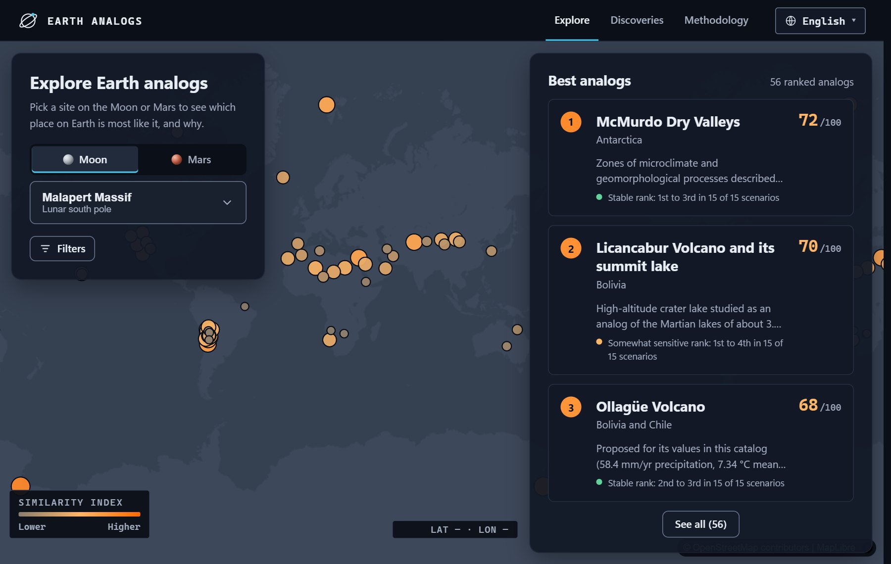
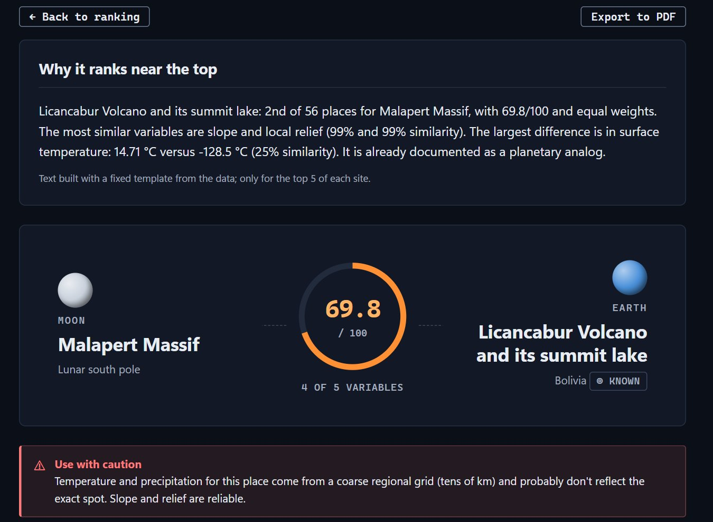
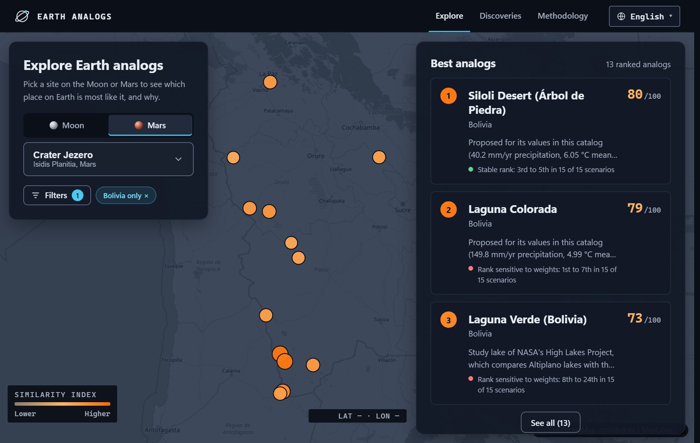
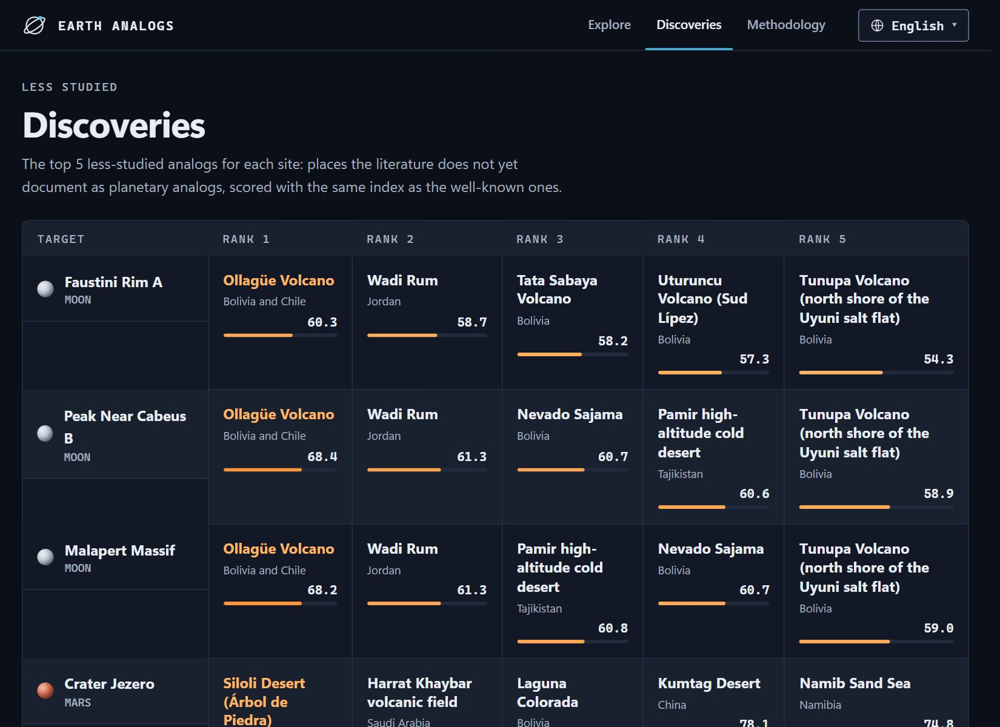

# Earth Analogs

**NASA Space Apps Challenge 2026, Cochabamba (Bolivia).** Challenge: *Identify Earth Locations that Analog the Permanent Moon Base Locations and Mars.*

*Resumen en español al final.*

## The problem

Teams preparing lunar bases and Mars landings test rovers, instruments and operations in Earth analogs, but, as the challenge itself notes, well-known analogs such as the Atacama Desert, Haughton Crater or Death Valley "are not entirely well characterized". And no place on Earth reproduces the Moon or Mars: each analog is good for some conditions and fails for others.

## What it does

Earth Analogs is a web app. You pick a candidate site on the Moon or Mars and get the places on Earth that most resemble it, with:

- **A similarity index from 0 to 100**, computed from five variables derived from NASA data and models: slope, local relief, mean temperature, aridity (annual precipitation) and albedo.
- **A map and a ranked list** of Earth analogs, with a **Bolivia-only filter** and a **"less-studied places only" filter**.
- **A side-by-side comparison** of each pair: value by value, a similarity radar, shared geology/ice/dust tags, and **where the analogy breaks down**.
- **A discoveries view** with the five best less-studied analogs for each site, evaluated with the same index as the well-known ones.
- **Adjustable weights** per variable, recomputed in the browser, with **mission goal profiles** (rover mobility, power and thermal systems, water and ice) and a **robustness badge** that shows how much each analog's rank moves when the weights change.
- **Up to three analogs on one radar** for the same site, with a table of the same numbers, and **Export to PDF** of a comparison.
- **A 3D globe** of the Earth, the Moon and Mars showing the selected site and its top analogs.
- **A methodology page** with the formula, sources and limitations.
- **A Spanish/English interface**, with a language selector in the header (`?lang=en` or `?lang=es` in the link also works). Site and place names, descriptions, fact sheets and the methodology page are available in both languages.

Every comparison also shows the limits no Earth analog can overcome: reduced gravity, the lunar vacuum, the thin Martian atmosphere and radiation.

| Explore: best Earth analogs for Malapert Massif | Compare: Malapert Massif and Licancabur Volcano |
| --- | --- |
|  |  |
| **Bolivia only, Jezero crater** | **Discoveries: best less-studied analogs** |
|  |  |

## Use it in 60 seconds

1. **Pick a body and a site**: Moon or Mars at the top of the left panel, then a site such as Malapert Massif or Jezero crater.
2. **Read the ranking**: the map and the list show the Earth places most like that site, with a score from 0 to 100. *Filters* shows only Bolivia, only less-studied places, or changes the weight of each variable.
3. **Open a place**: the comparison puts both places side by side, value by value, with the radar, the shared tags, the fact sheet with its references and **where the analogy breaks down**.
4. **See the less-studied candidates**: *Discoveries* lists the five best per site, and *Methodology* explains the formula, the sources and the limitations.

## Sites

| Body | Site | Why |
| --- | --- | --- |
| Moon | Faustini Rim A, Peak Near Cabeus B, Malapert Massif | Artemis III candidate regions near the lunar south pole (Faustini Rim A was in NASA's 2022 list of 13 and dropped in the 2024 list of 9) |
| Mars | Jezero crater, Gale crater, Arcadia Planitia | Perseverance and Curiosity landing sites, and a mid-latitude plain with widespread ground ice |

## How the index works

1. Each place is described by five variables derived from NASA data and models in a common 10 × 10 km window.
2. Relief and precipitation are log-transformed; every variable is normalized to 0–1 over all places together.
3. For each site–analog pair we take the absolute difference per variable, using only the variables both places have.
4. The distance is the weighted mean of those differences, and the score is `100 × (1 − distance)`; a pair needs at least three shared variables.
5. Qualitative tags (basalt, impact crater, evaporite, polar ice, permafrost, lava tubes…) are compared separately with the Jaccard index and shown next to the score.

Full method, choices, sensitivity tests and limitations: the *Methodology* page of the app, or [`docs/METODOLOGIA.en.md`](docs/METODOLOGIA.en.md) (English) and [`docs/METODOLOGIA.md`](docs/METODOLOGIA.md) (Spanish). The audit of which places count as documented analogs is in [`docs/AUDITORIA_KNOWN.md`](docs/AUDITORIA_KNOWN.md) (Spanish).

## Data

Every non-null value carries its source; missing values are `null`, never estimated.

- **Moon:** LRO LOLA polar elevation model (slope, relief) and LRO Diviner Polar Resource Product (mean temperature), from the NASA Planetary Data System.
- **Mars:** MGS MOLA MEGDR elevation (slope, relief) and the Mars Climate Database v6.2 (surface temperature and albedo).
- **Earth:** 56 candidate places (31 documented as planetary analogs, 25 less studied; 13 in Bolivia). Slope and relief come from Terrain Tiles on AWS (a composite of SRTM and other open elevation models) and, for four places where those tiles have no fine data (McMurdo Dry Valleys, Svalbard, La Corona and Manjanggul), from the 30 m Copernicus DEM; temperature, precipitation and albedo come from NASA POWER (MERRA-2 and CERES). POWER's grid is tens of kilometres wide, so temperature is biased for mountain and volcano candidates; those values are flagged in the data. Method: [`pipeline/earth/README.md`](pipeline/earth/README.md).
- **Globe textures:** NASA Blue Marble (via NASA GIBS), LRO WAC mosaic (via Moon Trek) and Viking MDIM 2.1 mosaic (via Mars Trek).

How each lunar and Martian value was extracted: [`pipeline/moon_mars/README.md`](pipeline/moon_mars/README.md). Credits and terms of use: [`docs/ATRIBUCION.md`](docs/ATRIBUCION.md).

## Run it locally

Requirements: Python 3.9+ (standard library only) and Node.js.

```bash
python pipeline/validate.py      # checks data/sites.json and data/candidates.json
python pipeline/similarity.py    # writes web/public/data/results.json
cd web
npm install
npm run dev
```

To try the interface with **invented demo data** (never presented as real): `npm run data:demo` inside `web/`.

The app is fully static: all results are computed offline in Python and the web only reads JSON files. No server and no AI calls at runtime.

## Use of AI tools

The team used AI assistants (Claude and ChatGPT) as tools to help write and review code, search and check literature, and draft texts. The idea, the method and the data decisions are the team's. By team rule every data value must cite an original source that a team member opened and checked, and the app makes no AI calls.

## License

The code is released under the [MIT License](LICENSE). The data come from sources with their own terms of use, listed with their credits in [`docs/ATRIBUCION.md`](docs/ATRIBUCION.md).

## Team

Dante (Moon and Mars data, comparison view, 3D globe), Fernando (technical lead, web app and map), Lian (Earth and Bolivia data, analog fact sheets), Sebastián (similarity index, validation and methodology), Noe (design) and Joel (requirements, documentation, pitch and QA).

## Resumen en español

Earth Analogs es una web que, dado un sitio candidato de base lunar o de aterrizaje en Marte, ordena los lugares de la Tierra que más se le parecen con un índice de 0 a 100. El índice usa cinco variables derivadas de datos y modelos de NASA: pendiente, relieve, temperatura media, aridez y albedo. Cada comparación muestra qué se parece, por cuánto y **dónde falla la analogía**. Incluye un filtro de Bolivia, una vista de lugares poco estudiados y un globo 3D. Todo se calcula de antemano con datos abiertos de NASA y de otras agencias, y cada valor lleva su fuente.

Para el equipo: el contexto, las tareas y el flujo de trabajo están en [`CONTEXT.md`](CONTEXT.md), [`TASKS.md`](TASKS.md), [`GIT.md`](GIT.md) y [`AI.md`](AI.md).
